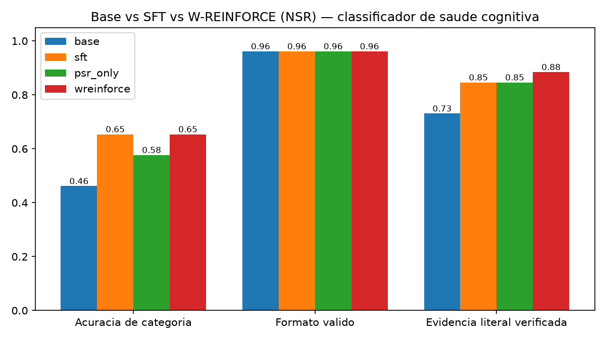

# Cognitive Wiki OS — MLovers / HackBrasil 2026

Aplicativo **local** que lê o histórico de conversas da pessoa com IAs e devolve duas coisas: um
diagnóstico de saúde cognitiva no uso de IA e uma wiki pessoal em grafo no Obsidian, expandida com
pesquisa web real e consultável por LLMs via MCP.

## Integrantes do grupo
- Ana Júlia Amaro Pereira Rocha
- Gustavo Tironi
- Kauan Mariani Ferreira
- Sillas Rocha da Costa

## 1. O que é
O projeto une duas vertentes complementares, rodando na máquina do usuário e expostas por um app web local:

- **Diagnóstico de saúde cognitiva (anti-brain-rot):** classifica cada conversa em `blind_delegation`
  (pede a solução pronta sem tentar), `frustration_loop` (repete o erro sem investigar),
  `socratic_learning` (busca intuição e testa hipóteses) ou `active_cocreation` (traz trabalho próprio
  e usa a IA para revisar/decidir). Gera métricas, um score de 0 a 100 e recomendações concretas, sempre
  com uma citação literal da fala do usuário como evidência.
- **LLM Wiki em grafo no Obsidian:** transforma as conversas em notas de conceito (**nós azuis**), marca
  conceitos com delegação cega (**nós vermelhos**, tag `alert/brain-rot`) e pesquisa na web os tópicos
  que faltam na borda do grafo (**nós verdes**, com URLs reais). O grafo e o diagnóstico ficam
  disponíveis para Claude Code e Claude Desktop via **MCP**.

Fluxo em 6 passos: **1)** coletar conversas locais e imports; **2)** diagnosticar e agregar score, métricas
e recomendações; **3)** ingerir os conceitos no Obsidian com `[[wikilinks]]`; **4)** expandir a fronteira
com notas verdes do Firecrawl; **5)** expor vault + diagnóstico via MCP; **6)** enviar o relatório por
e-mail (Resend) e abrir o checkout Pro (AbacatePay).

## 2. Arquitetura

| arquivo | responsabilidade |
|---|---|
| `llm.py` | única porta para o Claude: `ask_json(prompt)` via `claude-agent-sdk`, com o login do Claude Code (sem API key). |
| `collector.py` | lê `~/.claude/projects/**/*.jsonl`, `~/.codex/sessions/**/*.jsonl` e exports em `data/imports/`; roda a extração web human-in-the-loop → `data/conversations.json`. |
| `diagnostics.py` | prompt do classificador, verificador de 3 camadas, métricas sem LLM, inferência por conversa (`mock`/`claude`/`local`) e relatório agregado → `data/diagnostics.json`. |
| `obsidian.py` | o wiki: lê o vault, ingere conversas como notas de conceito, aplica as cores do grafo e respeita edições/deleções. Exporta `read_vault()` e `write_note()`. |
| `research.py` | escolhe conceitos centrais, pede ao LLM tópicos vizinhos, pesquisa no Firecrawl e cria as notas verdes → `data/frontier_research.json`. |
| `mcp_server.py` | FastMCP (stdio; `--http` opcional) expondo vault + diagnóstico. |
| `integrations.py` | e-mail do relatório (Resend) e checkout PIX (AbacatePay); sem chave, gera preview local. |
| `app.py` + `index.html` | FastAPI em `127.0.0.1:8765` + HTML/CSS/JS puro; abre o navegador e dispara os módulos. |
| `train_wreinforce.py` | gera o dataset sintético, faz o SFT baseline, treina com W-REINFORCE, avalia e plota. |

**Contratos.** Cada módulo roda isolado: se `data/<arquivo>.json` não existir, usa `mock/<arquivo>.json`.
`data/` é gitignored; exemplos versionados ficam em `mock/`.

- `data/conversations.json`: `{"id", "source": "claude_code|codex|chatgpt_web|claude_web|gemini_web",
  "title", "created_at", "messages": [{"role": "user|assistant", "content", "timestamp"}]}`. Só texto
  humano/assistente — tool calls, tool results e system-reminders ficam de fora.
- `data/diagnostics.json`: `{"generated_at", "cognitive_health_score": 0-100, "summary_metrics":
  {"blind_delegation_pct", "socratic_pct", "frustration_loop_pct", "active_cocreation_pct",
  "avg_prompt_effort_ratio"}, "recommendations", "conversation_diagnoses": [{"conversation_id", "category",
  "severity": 1-5, "evidence_quote", "grounding_verified", "topics", "recommendation", "backend"}]}`.
- `data/frontier_research.json`: `[{"topic", "why", "note_title", "sources": [{"title", "url"}]}]`.
- **Vault** (`OBSIDIAN_VAULT_PATH`, padrão `~/AIWikiVault`): uma nota `.md` por conceito com
  `type: concept`, `source: prompt|firecrawl|human`, `tags`, `source_urls` (verdes), `conversations`.
  Cores em `.obsidian/graph.json`: vermelho (`alert/brain-rot`), verde (`source/firecrawl`), azul
  (`source/prompt`).

**Sync bidirecional.** `<vault>/.wiki_state.json` guarda as notas criadas pelo agente e as conversas já
ingeridas. O agente **nunca reescreve texto existente**: só cria notas ou acrescenta seções/links ao final.
Nota criada pelo agente que sumiu do disco = usuário deletou → vai para `ignored` e nunca é recriada.
Notas criadas à mão entram no grafo como `source: human`.

## 3. Instalação
Pré-requisitos: **Python 3.11+**; **[uv](https://docs.astral.sh/uv/)** (recomendado) ou `venv` + `pip`;
**Node.js/npx** só para a extração web; **Claude Code** instalado e logado (o `llm.py` usa esse login,
sem API key); **Obsidian** instalado. Abra o terminal na pasta do projeto (a que contém `app.py`).

**Windows (PowerShell)** — com uv (recomendado) e, abaixo, sem uv:
```powershell
uv sync
uv run python app.py

python -m venv .venv
.\.venv\Scripts\Activate.ps1    # se bloquear: Set-ExecutionPolicy -Scope Process Bypass
python -m pip install fastapi uvicorn python-dotenv pyyaml claude-agent-sdk fastmcp firecrawl-py resend certifi
Copy-Item .env.example .env
python app.py
```
No Windows, para rodar os módulos pela linha de comando (`python diagnostics.py` etc.) sem erro de
acentuação no console, ative o modo UTF-8 do Python uma vez por terminal: `$env:PYTHONUTF8 = "1"`
(o `app.py` já faz isso sozinho).

**macOS / Linux** — com uv e, abaixo, sem uv:
```bash
uv sync
uv run python app.py

python3 -m venv .venv
source .venv/bin/activate
python -m pip install fastapi uvicorn python-dotenv pyyaml claude-agent-sdk fastmcp firecrawl-py resend certifi
cp .env.example .env
python app.py
```
O app sobe em `http://127.0.0.1:8765` e abre o navegador; use `--no-browser` para não abrir ou
`--port 9000` para trocar a porta. Para treinar o modelo (só em máquina com GPU): `uv sync --extra train`
(ou `pip install torch transformers peft trl accelerate datasets matplotlib`).
**Obsidian:** crie `~/AIWikiVault` (ou aponte `OBSIDIAN_VAULT_PATH` para outra pasta) e use
*Open folder as vault* uma única vez. O app escreve as notas e as cores do grafo nessa pasta.

## 4. Configuração (`.env`)
Copie `.env.example` para `.env`. Tudo é opcional: sem chave, o módulo cai em mock/preview e avisa com
`print`, sem quebrar.

| variável | para que serve | sem ela |
|---|---|---|
| `FIRECRAWL_API_KEY` | pesquisa real das notas verdes | nenhuma nota verde é criada; os tópicos ainda vão para `frontier_research.json` |
| `RESEND_API_KEY` | envio do relatório por e-mail | relatório vira o preview `data/last_report.html` |
| `USER_EMAIL` | destinatário padrão | envio desativado (dá para passar `--to`) |
| `ABACATEPAY_API_KEY` | checkout PIX real do plano Pro | URL de demo `http://127.0.0.1:8765/?pro=demo` |
| `OBSIDIAN_VAULT_PATH` | pasta do vault | `~/AIWikiVault` |
| `DIAG_BACKEND` | `mock`, `claude` ou `local` | `mock` (heurística por palavra-chave) |
| `LOCAL_MODEL` | pasta do adapter LoRA ou id de modelo HF | backend `local` indisponível |
| `LOCAL_BASE_MODEL` | modelo base do adapter (padrão `Qwen/Qwen2.5-0.5B-Instruct`) | usa o padrão |
| `LLM_MODEL` | alias do Claude (`haiku`, `sonnet`, `opus`) | `haiku` |

## 5. Uso
**Pelo app** (`python app.py`), clique na ordem: **1** Coletar conversas locais → **2** Extrair da web
(escolha ChatGPT/Claude/Gemini) → **3** Diagnosticar → **4** Atualizar wiki no Obsidian → **5** Pesquisar
fronteira (Firecrawl) → **6** Enviar relatório por e-mail → **7** Abrir no Obsidian → **8** Assinar Pro.

**Pela CLI** (com o venv ativado; usuários de `uv` prefixam com `uv run`):
```bash
python collector.py                        # local + exports (200 mais recentes)
python collector.py --limit 50
python collector.py --web chatgpt          # extração web (respeita 15 dias)
python collector.py --web gemini --force   # ignora o intervalo de 15 dias
python diagnostics.py                      # usa DIAG_BACKEND (padrão mock)
python diagnostics.py --backend claude     # classifica com o Claude da sua conta
python diagnostics.py --backend local      # usa LOCAL_MODEL
python obsidian.py                         # ingere conversas (pede conceitos ao LLM)
python obsidian.py --no-llm                # usa só os topics do diagnóstico
python research.py --n 3                   # 3 tópicos de fronteira + notas verdes
python integrations.py email               # envia (ou grava preview)
python integrations.py email --to voce@exemplo.com
python integrations.py checkout            # imprime a URL do checkout
```

## 6. MCP
Registre no **Claude Code** (caminhos absolutos):
```bash
# macOS/Linux
claude mcp add cognitive-wiki -- "/caminho/para/.venv/bin/python" "/caminho/para/mcp_server.py"
# Windows
claude mcp add cognitive-wiki -- "C:\caminho\para\.venv\Scripts\python.exe" "C:\caminho\para\mcp_server.py"
```
No **Claude Desktop**, edite `~/Library/Application Support/Claude/claude_desktop_config.json` (macOS)
ou `%APPDATA%\Claude\claude_desktop_config.json` (Windows):
```json
{
  "mcpServers": {
    "cognitive-wiki": {
      "command": "/caminho/para/.venv/bin/python",
      "args": ["/caminho/para/mcp_server.py"]
    }
  }
}
```
No Windows, use `"command": "C:\\caminho\\para\\.venv\\Scripts\\python.exe"` e o caminho do
`mcp_server.py` em `args`. Também dá para rodar `python mcp_server.py` (stdio) ou
`python mcp_server.py --http` (`127.0.0.1:8000/mcp`). Ferramentas: `search_wiki(query, limit)`,
`read_node(title)`, `get_graph_neighbors(title)`, `list_frontier_nodes()`, `get_cognitive_summary()`.

## 7. Extração web (human-in-the-loop)
ChatGPT, Claude Web e Gemini não têm export simples via API. O `collector.py` roda um agente
(`claude-agent-sdk`) com o MCP `chrome-devtools`, num perfil de Chrome persistente em
`~/.cognitive_wiki/chrome-profile`, seguindo as instruções de `skills/extract_*.md`.

O agente abre o site, detecta a tela de login e responde `AGUARDANDO_LOGIN`. **O login é sempre feito
pela pessoa**, na janela do Chrome — o agente nunca digita e-mail/senha nem resolve CAPTCHA/2FA. A cada
15 segundos (por até 5 minutos) ele confere a página; após o login, conclui a extração, salva
`data/imports/<plataforma>_web.json` e roda o `collect()` de novo. A extração é limitada a uma vez a
cada **15 dias** por plataforma (`data/web_extraction_state.json`); o botão do app usa `force` e a CLI
aceita `--force`. Alternativa: baixe o export oficial e coloque o `.zip`/`.json` em `data/imports/`.

## 8. Machine Learning: W-REINFORCE / NSR
Pós-treino de um modelo pequeno com **RLVR** usando **Negative Reinforcement (W-REINFORCE / NSR,
arXiv 2506.01347)**: a recompensa não vem de um reward model, mas do verificador determinístico
`diagnostics.verify()`, em 3 camadas: **1) formato** — `<think>...</think>` + JSON com `category`,
`severity`, `evidence_quote`, `topics` e `recommendation` válidos; **2) categoria** — quando há gabarito,
a categoria prevista tem que bater; **3) grounding literal** — a `evidence_quote` (≥ 10 caracteres)
precisa aparecer **literalmente** numa fala do usuário, ignorando caixa e espaços.

Só com as três OK a recompensa é `+1`; caso contrário, `-1`. O mesmo `build_prompt` da inferência é
usado no treino, então mudar o classificador muda o que o modelo aprende.

A loss é a do paper, sem baseline e sem KL: `loss = -(λ·Σ_{r=+1} log π(y) − Σ_{r=-1} log π(y)) / tokens`,
com λ = 0,1. Para estabilidade com recompensa esparsa, a função tem dois cuidados: as respostas truncadas
ficam fora da loss (*overlong filtering*), e o NSR não penaliza o token EOS. Sem isso, o modelo para de
terminar as respostas e colapsa. Instale o extra de treino (`uv sync --extra train`) e rode:

```bash
python train_wreinforce.py gen-data --n 1500                      # dataset sintetico rotulado (Claude)
python train_wreinforce.py sft  --model Qwen/Qwen3-4B --out outputs/sft --epochs 2
python train_wreinforce.py rl   --model Qwen/Qwen3-4B --init-adapter outputs/sft --out outputs/wr \
       --steps 300 --prompts-per-step 16 --rollouts 8 --lam 0.1 --lr 2e-6
python train_wreinforce.py eval --model Qwen/Qwen3-4B --adapter outputs/wr --out outputs/wr/eval.json
python train_wreinforce.py plot --runs outputs/base outputs/sft outputs/wr --out outputs/comparison.png
```
Ablações: `--lam 1.0` (REINFORCE padrão) e `--psr-only` (só reforço positivo).

**Teste pequeno já rodado** (Qwen2.5-1.5B-Instruct, RTX A4000 16 GB, 200 conversas sintéticas, 26 de
teste, 60 passos de RL partindo do SFT):

| Modelo | Formato válido | Acurácia de categoria | Evidência literal verificada |
|---|---|---|---|
| Base | 96% | 46% | 73% |
| SFT | 96% | 65% | 85% |
| SFT + só PSR | 96% | 58% | 85% |
| **SFT + W-REINFORCE** | 96% | 65% | **88%** |



Durante o treino, a recompensa do W-REINFORCE subiu de −0,42 para −0,17 (de 9 para 13 rollouts corretos
em 32), sem truncamento. Só PSR caiu de −0,33 para −0,46 e encurtou as respostas, o colapso de
diversidade que o paper descreve. Com 26 exemplos de teste, cada ponto equivale a ~4%: o resultado é
direcional, e a escala (modelo de 4-7B, dataset de 1.500) fica para a GPU grande. Num modelo de 0.5B e com
lr alto (2e-5), o termo negativo colapsa o modelo (recompensa positiva rara demais); use lr ≈ 1e-6 a 2e-6.
**Dois LLMs, ambos por API (o app não carrega modelo nenhum):**

| Job | LLM |
|---|---|
| Classificar cada conversa (varredura em massa) | **modelo treinado**, servido via vLLM (`llm.ask_small`) |
| Ingest do wiki (varredura) | LLM geral rápido, `LLM_MODEL_FAST` (Haiku) |
| Recomendações, fronteira, notas verdes, agente web | LLM geral de decisão, `LLM_MODEL` (Sonnet) |

O LLM geral usa o login do Claude Code via `claude-agent-sdk` (dá para trocar por API depois). Para
servir o modelo treinado numa máquina com GPU (API compatível com OpenAI):

```bash
pip install vllm   # numa venv separada, na máquina da GPU
vllm serve Qwen/Qwen2.5-1.5B-Instruct --enable-lora --max-lora-rank 16 \
     --lora-modules cognitive=/caminho/do/adapter --max-model-len 4096 \
     --host 0.0.0.0 --port 8000 --api-key <chave-secreta>
```
E, no `.env` da máquina do app:

```bash
DIAG_BACKEND=small
SMALL_MODEL_URL=http://IP-DA-GPU:8000
SMALL_MODEL_NAME=cognitive
SMALL_MODEL_API_KEY=<chave-secreta>
```
Se o servidor estiver fora do ar ou a resposta não passar no verificador, aquela conversa cai na
heurística mock (nunca quebra).

## 9. Privacidade
- **Fica local:** conversas brutas, `data/*.json`, vault Obsidian, estado do sync e o histórico lido de `~/.claude`/`~/.codex` — nada vai para um servidor nosso.
- **Claude (conta do usuário):** o prompt com trechos das conversas vai ao Claude via `claude-agent-sdk`, com o login do Claude Code — sem API key e sem intermediário.
- **Firecrawl:** recebe apenas a query de busca (nome do tópico), nunca as conversas.
- **Resend:** recebe o relatório (score, métricas, recomendações, links das fontes e até 3 citações curtas de evidência), nunca as conversas completas.
- **AbacatePay:** recebe apenas os dados do produto/checkout.

## 10. Roteiro da demo (3 minutos)
1. **0:00–0:20** — `python app.py`; mostre o score de `mock/` com o selo "dados de exemplo".
2. **0:20–0:50** — **1 · Coletar conversas locais**; mostre a contagem por fonte (Claude Code/Codex lidos do disco).
3. **0:50–1:20** — **3 · Diagnosticar**; mostre score, as 4 métricas e um card com categoria, severidade e a citação literal verificada.
4. **1:20–1:50** — **4 · Atualizar wiki no Obsidian**; abra o grafo com nós azuis e vermelhos.
5. **1:50–2:20** — **5 · Pesquisar fronteira**; mostre uma nota verde com as URLs das fontes.
6. **2:20–2:40** — no Claude Code, peça "use o cognitive-wiki para resumir minha saúde cognitiva" e experimente `search_wiki`/`get_graph_neighbors`.
7. **2:40–3:00** — **6 · Enviar relatório** (ou preview) e **8 · Assinar Pro**; feche reforçando que a recompensa do W-REINFORCE é o verificador de 3 camadas, não um LLM juiz.
